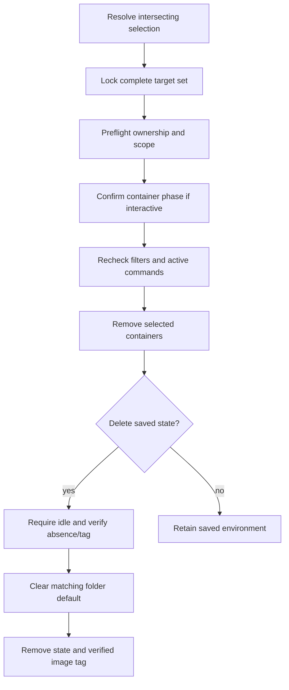
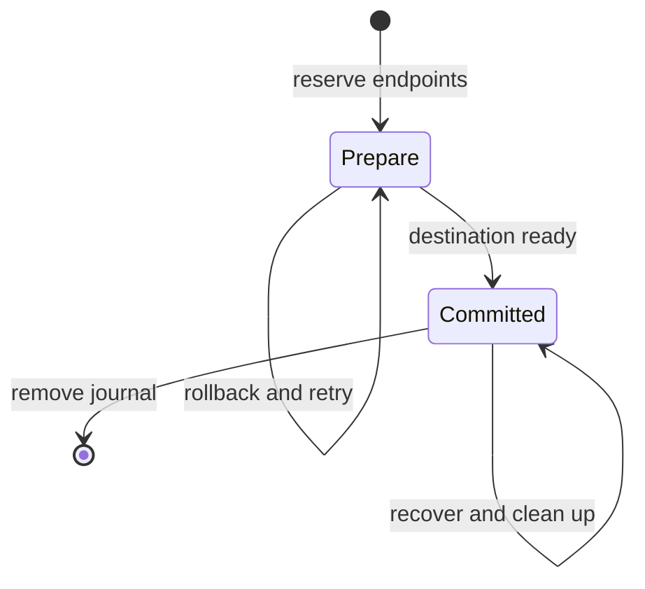

# State, locking, and transfers

The saved session is the top-level environment model. Docker inventory supplies live runtime facts, but container/image absence does not erase identity, history or the applied comparison baseline. `store` owns durable state. `app` combines it with verified Docker state before transitions.

## Identity and ownership

`environment.ContainerPrefix` defines the `dbx-` lookup convention independently of `docker.Namespace`, which defines `dbx.*` labels and creation-attempt image aliases.

One immutable 12-character hexadecimal ID identifies the saved session and its directory. `settings` contains editable workspace/name, config references, and keep-running intent. The public name is `dbx-<workspace-hint>-<id>.<local-name>`, derived from JSON rather than stored independently. `app.Locate` extracts its ID, reads saved metadata, and requires the complete public name to match before use. Captured services may address IDs internally. The CLI rejects raw IDs. Docker names capture that public name plus an eight-character creation suffix. Image aliases use the full creation token without readable hints. Both remain creation-attempt resources, not editable naming authority.

`store.Find` looks up an ID or workspace/name from saved records, without config resolution or a persistent index. Folder-only lookup reads its explicit default ID. `state/folder-defaults.json` uses schema 2 with a `defaults` map from canonical folder paths to session IDs. Only selected folders appear. Clearing a default removes its entry. An absent file means no selections. Malformed defaults are errors. Name reuse never inherits an old ID selection.

Docker ownership uses installation ID, ownership version, and session ID. Workspace/name labels are descriptive. Existing containers are inspected by recorded Docker ID, with image/instance checks. Names alone never authorize adoption or mutation.

Images carry installation ownership and final session tags. Removing a tag requires verifying both ownership and its expected image association. A mutable name alone does not authorize deletion.

## Record structure

`sessions/<id>/session.json` holds:

- immutable `id`, validated relative `state_tree`, and activity metadata.
- `settings`: workspace, local name, ordered config references, and `manual_start`.
- `applied`: current creation/launch settings, image/container association, harness layout, compact comparison inputs and fingerprints.

Schema `8` validates settings and applied state independently. Differences between desired and applied settings are pending changes, not corruption. Managed store sources must agree with the ID and current state tree. Applied mounts must agree with applied inputs, not desired settings. `applied.inputs.sources` retains applied provenance for config usage, not historical recovery authority. No directory name is persisted. Per-tree content digests replace per-file input inventories. Setup bytes and env restoration references are not persisted.

Records contain public settings, paths, modes, and hashes, not file contents or env/auth values. Raw env diagnostics are redacted. Records are atomically replaced with restrictive permissions. Invalid records remain errors rather than being treated as missing.

Container creation/replacement commits image and container baselines. `Record.ApplyRuntime` advances runtime inputs with their fingerprint at application commit points. Status and warning generation never alter either baseline.

## Required migrations

Ordinary readers reject preceding records. The consent gate recognizes schemas 6/7 without resolving Docker/config. Noninteractive/JSON calls cannot consent. No aliases, ordinary old-format readers, or importer are provided. Older builds must not use the home after conversion.

### Session identity conversion

Conversion holds namespace plus old/new identity locks, refuses active commands and pending transfers, and preflights all destination paths and linked ownership. Defaults publish their complete checked shortened-ID mapping before records move. Retries cannot infer lost old identity associations.

Harness state moves into `data/base`, IDs/references change to 12 characters, and linked bind-backed containers are removed. Current-namespace owned images may be retagged. Applied comparison inputs are not replaced with current configs. A preceding header remains until atomic current-record publication, so interrupted directory/tree moves can resume.

### Folder-default conversion

The same gate offers a separate conversion for the preceding per-folder files. It uses the namespace, preceding folder locks, and current defaults lock. It publishes the complete mapping before removing known old files and retries matching partial conversions without overwriting conflicting selections.

The conversion preserves stale session IDs rather than guessing new defaults. It does not touch Docker or session data. Ordinary defaults readers only support the new file.

## Locks and leases

Session operation locks are keyed by immutable ID under `state/locks/sessions/`, outside removable data directories. Attached-command leases use `state/leases/<id>/`. Changing a directory or losing a record cannot bypass the same session's lock or active commands. Record reads see an atomic snapshot or absence. Mutations reload under the operation lock.

| Lock / record | Lifetime and job |
|---|---|
| Installation lock | Serialize initial home/installation identity creation |
| Configuration-owner lock | Serialize publication or mutation of one source owner |
| Name-namespace lock | Serialize creation, rename, workspace edits, and transfer name reservations |
| Session operation lock | Serialize ownership checks and lifecycle transitions |
| Folder-defaults lock | Serialize updates to the complete folder-to-session mapping |
| Attached-command lease | Represent a foreground command while its operation lock is released |
| SSH owner/master flocks | Govern transient SSH process lifetime, independently of session operation locks |

Operations involving several environments acquire the complete session lock set in sorted unique session-ID order (Move shares one ID lock across its two directories). Name-changing operations acquire the namespace lock first. Acquire `state/locks/folder-defaults.lock` after any session locks. Never acquire a session lock while holding the defaults lock. Every folder shares this lock so concurrent updates cannot overwrite each other's entries. Bulk operations retain their complete session lock set through preflight and mutation.

Default selection prompts before locking, then reloads the chosen session under its operation lock and verifies its ID before acquiring the defaults lock. Clearing needs only the defaults lock. Resolving a default releases that lock before acquiring the session lock. The chosen ID is an invocation snapshot, not a reference that can retarget midway through an operation.

Source edits use the session operation lock and compare ID, workspace, and the displayed source list. Config-directory edits use only their own owner lock and same-field conflict checks. Shared-use reporting never locks all referring sessions.

Leases use Linux process start ticks and boot identity, not PID alone. Inspection reads active state without reaping it. Mutations can reap provably stale leases. Corrupt or unverifiable ones fail closed. Session deletion requires idleness even when container removal is forced.

SSH lifetime locks deliberately remain in transient connection directories: supervisors hold open inodes, so revocation still works if a path is removed. They are not substitutes for external environment-operation locks.

## Inventory and status

Inventory joins one installation-filtered Docker list and batched inspection with saved directories and pending-transfer endpoints. `app.InventoryReport` separates `sessions` from `unmatched_containers`.

| Observation | Representation |
|---|---|
| Valid session and container | Session row with live runtime facts |
| Session without container | Retained session row, marked missing |
| Managed container without record | Separate unmatched-container diagnostic |
| Corrupt/incomplete saved state | Session diagnostic, not fabricated valid state |
| Pending endpoint without record | Inspectable reserved endpoint |

Folder filtering uses saved workspace settings, or descriptive workspace labels for unmatched containers. Unassignable broken entries remain visible in global inventory. Default-state errors appear separately in `default_errors`. They do not hide sessions. Listing does not resolve desired configuration and never repairs or adopts resources.

Bulk status enriches the same inventory with the normal resolver and `environment.CompareInputs`. Runtime state remains independent of configuration health: a missing container can still have comparable inputs, while a running container can have invalid desired config.

Single-target `app.Status` reads the record and live leases under the operation lock, inspects the linked container, and uses the same comparison. `StatusDetails` adds full `record` and `active` fields without bloating bulk rows. It reads the workspace default after acquiring the session lock and matches the durable ID. Default-state read errors appear separately as `default_error`, preserving explicitly selected session details. Pending transfers skip desired resolution because their transaction, not current configuration, governs recovery.

Last activity means recorded Devbox operations, not filesystem activity or only harness launches. Container creation time in listing comes from Docker, independently of durable session creation time.

## Deletion transaction

`app.Delete` owns both runtime and saved-data phases. Explicit CLI `--container` or `--session` selects scope without a confirmation callback. The unscoped interactive command supplies a default-no callback for each phase. The frontend combines an explicit scope with that callback: container-only never asks about or removes saved data. Whole-session deletion confirms each applicable phase separately. Preview and execution share the selected scope, and dry runs never call confirmations. Non-interactive and JSON calls must provide scope.

Explicit saved-data deletion is preflighted before container removal and rechecked afterward. Container failures do not advance into state deletion. `--force` only relaxes attached-command protection for the runtime phase. It cannot expand scope or bypass pending transfers and saved-state idleness.

The complete operation-lock set spans confirmations and both phases. `removeSavedSession` persists a matching-ID default clear before deleting state, while retaining the session operation lock. If deletion then fails, the surviving session may have no default. An old choice is never restored over a newer one. Container-only deletion and dry runs do not clear defaults. External lock files survive deletion. If cancellation or failure occurs after containers have been removed, remaining state is retained rather than pretending the whole operation rolled back.

An incomplete creation directory has no session ID. Its cleanup therefore holds the name-namespace lock before any session locks, excluding concurrent creation and transfers through confirmation and removal. Recheck record absence, transfer reservations, directory identity, and bind use by any container before removal. Without recorded identity, cleanup cannot authorize image, default, or lease mutations.

Selection requests contain selectors and filters, never mutable discovery bookkeeping. Discovery returns ordered targets carrying record expectations, lock ownership and any pinned container instance together. Preview results retain captured targets for a later form. Saved targets resolve by their captured ID, not a changed folder default, while incomplete targets retain their directory snapshot.

Selection filters intersect. Age uses recorded activity, and unknown activity is not guessed to be old. Activity and orphan status are rechecked under lock, including after confirmation, before deletion records its own activity. Dry-run preflight examines leases without reaping them. This prevents a stale preview or prompt from selecting a newly active/recovered environment.

## Transfer state machine

`app/transfer.go` owns `copy` / `copy --move` orchestration. `store` owns journal persistence and portable store copying. An external `state/transfers/<source-id>/journal.json` reserves both endpoint bindings. `destination.json` holds the private prepared record.

Unique endpoint IDs are locked in sorted order. Move uses one lock for both backing trees. Ordinary `Locked.Load` rejects pending work, while inventory and transfer operations can inspect it. Pending lookup scans unfinished journals. Corrupt journals fail mutations closed because endpoint reservations cannot be trusted.

The journal stores endpoint identities, session IDs, mode/phase, and intended running state. It contains no env/auth values. Destination creation uses the allocated ID, so retries cannot create a different session.

Journal schema 5 pins bindings, IDs, source/destination tree paths, source container/image association, and the destination attempt name. Old unfinished journals must be completed or aborted using the preceding build before identity conversion or switching Docker naming formats. `--as` selects another local name. Without it, the source's local name is retained. Retry guidance derives the exact source public name from the pinned binding and ID, retaining destination and `--as` independently of defaults or workspace availability.

Internal modes are `clone` for `copy` and `relocate` for `copy --move`. Harness capabilities and JSON output use these same values.

### Prepare: source is authoritative

The engine validates current portability declarations and requires the source's active definition to remain unchanged. `copy` requires a stopped or absent source. `copy --move` may stop a running source and remember its intent. Both require idle endpoints and an unused destination.

Only declared environment stores and ownership manifests are copied. Auth overlays, cache stores, records, leases, and SSH runtime data are excluded. Workspace files and container-layer tools are not part of the state tree. Symlinks are copied as opaque entries without traversal. Special files are rejected.

OpenCode's database contains cached credentials and is transferred unchanged. Its shared auth directory is excluded. The next launch replaces copied credentials from that directory. Pending auth write-back retains source authority across a copy.

Copy allocates a new ID directory. Move allocates another data tree under the same ID. Neither changes the source record or tree during preparation. Destination resolution preserves the source reference order and kind. Relative references expand against the destination workspace. Fixed references stay absolute. Config directories are not copied. Resolution uses the normal configuration pipeline. Image building, synchronization, setup, and runtime installation follow ordinary creation. `copy` leaves the destination stopped. `copy --move` restores the source's original running intent at the destination.

If preparation fails, bounded rollback cleans the destination attempt and restarts a previously running source. Attempt-specific image aliases never replace the source alias. The journal remains pending. A preparation retry resolves current config and recopies the authoritative source because rollback may have restarted it and allowed its state to change. Config repair must not be rejected as a changed transfer contract. Only endpoints, mode and source identity stay pinned.

An explicit `copy <source-session> --abort` can abandon preparation without resolving config or loading current harness definitions. It requires idle endpoints and intact source stores, verifies/removes the destination attempt, restores source running intent and only then removes the journal. Failure retains the reservation for retry. It never aborts commitment. Corrupt journals identify their path and fail closed rather than guessing endpoints or deleting a reservation.

### Committed: destination is authoritative

Publishing `committed` changes authority before canonical-record publication or source removal. Recovery first publishes the verified private destination record, then removes the pinned source runtime and old tree without deleting Move's ID directory. Once publication is attempted, rollback cannot delete the destination: a directory sync error can occur after rename already succeeded.

A committed retry never copies source state again. It verifies the destination and finishes source cleanup. If destination runtime is missing, cleanup still finishes without resolving config or rebuilding it. After the journal releases the endpoints, explicit recreation can rebuild against the committed backing stores. Copying again here could overwrite newer destination history with stale source data.

The external journal and prepared record survive source-tree or source-record loss. Committed Move cleanup clears the matching old-folder default and removes only the retired tree/runtime, never the live session root. The journal supplies exact identity and instance expectations. Copy preserves source defaults. Move clears only a matching source default and never selects a destination default. Only completed cleanup removes the journal and releases both names. `copy` creates a new session ID. `copy --move` preserves it. No permanent lineage record is needed after completion.
